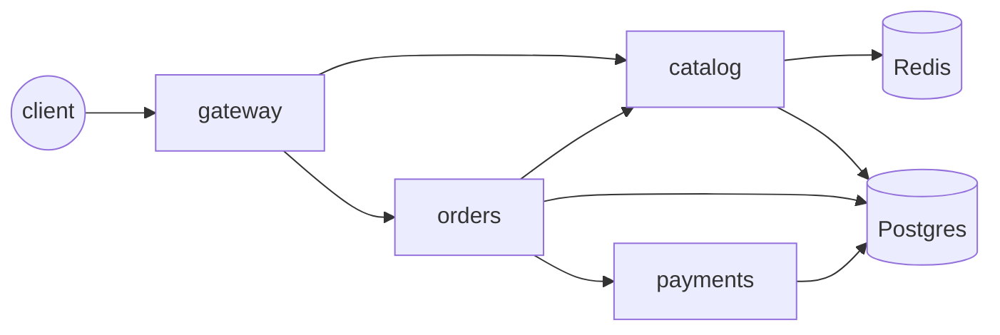

# Demo system

A small shop used to develop and benchmark IncidentLens. The business logic is trivial on purpose. What matters is the call graph, so faults have somewhere to propagate.



| Service | Language | Calls | Owns |
|---|---|---|---|
| `gateway` | Go | catalog, orders | nothing, it only forwards |
| `catalog` | Python (FastAPI) | Postgres, Redis | `products` in database `catalog` |
| `orders` | Go | catalog, payments, Postgres | `carts`, `cart_items`, `orders` in database `orders` |
| `payments` | Go | Postgres | `payments` in database `payments` |

All three databases live in one Postgres instance, so in the service graph they share a single `postgresql@postgres` node. That is deliberate: a shared database is a common way for one service's problem to become everyone's.

## Running it

The services are part of the local stack:

```sh
make up      # builds the images, starts everything, waits for health checks
make smoke   # runs a checkout through the gateway and checks the spans in ClickHouse
```

Once the gateway is healthy, the `loadgen` service sends about 20 requests per second through it, a mix of browsing, carts and checkouts that rises and falls over an hour. See [`loadgen/README.md`](loadgen/README.md) for the mix and how to change the rate.

The gateway listens on `127.0.0.1:8080` (`GATEWAY_PORT` to change it). The other services are only reachable inside the compose network.

## API

Everything goes through the gateway. The flow is browse, add to cart, check out.

| Gateway route | Forwarded to | Notes |
|---|---|---|
| `GET /api/products` | catalog `GET /products` | 48 seeded products, IDs 1 to 48 |
| `GET /api/products/{id}` | catalog `GET /products/{id}` | 404 for unknown IDs |
| `POST /api/carts` | orders `POST /carts` | returns the new cart with its `id` |
| `GET /api/carts/{id}` | orders `GET /carts/{id}` | |
| `POST /api/carts/{id}/items` | orders `POST /carts/{id}/items` | body `{"product_id": 7, "quantity": 2}`, orders looks up the price in catalog |
| `POST /api/carts/{id}/checkout` | orders `POST /carts/{id}/checkout` | orders claims the cart, creates the order, charges it through payments `POST /payments`, then closes the cart |

```sh
curl -s localhost:8080/api/products/7
cart=$(curl -s -X POST localhost:8080/api/carts | sed -E 's/.*"id":"([^"]+)".*/\1/')
curl -s -X POST -d '{"product_id":7,"quantity":2}' localhost:8080/api/carts/$cart/items
curl -s -X POST localhost:8080/api/carts/$cart/checkout
```

Errors keep their meaning across hops: a 4xx from a callee is passed back unchanged, anything else (5xx, timeout, connection refused) becomes a 502. 4xx responses carry a message (`cart is empty`); 5xx responses only carry the status text, and the cause goes to the error log and the span. Timeouts on outbound calls are 2s to catalog, 3s to payments and 5s from the gateway to orders.

### Checkout

A cart is `open`, then `checking_out` while a checkout runs, then `checked_out`. The checkout claims the cart with a conditional update, so two concurrent checkouts of one cart cannot both charge it, and items can only be added to an `open` cart.

Once claimed, the checkout runs to the end on its own 8s deadline even if the caller gives up, because payments may already have charged. How it ends:

| What happened | Order | Cart | Response |
|---|---|---|---|
| Payment captured | `paid` | `checked_out` | 201 |
| payments answered with an error | `payment_failed` | `open` again | 502, or the 4xx |
| payments did not answer (timeout, connection error) | stays `pending` | stays `checking_out` | 502 |

The last case is deliberate: nobody knows whether the charge went through, so the data says so instead of guessing.

catalog reads through a Redis cache (30s for the list, 60s per product). If Redis fails, reads fall back to Postgres and a warning is logged, so a cache outage shows up as extra Postgres load and latency rather than errors.

## Telemetry

Every service follows [docs/telemetry-conventions.md](../docs/telemetry-conventions.md) and exports traces, metrics and logs over OTLP gRPC to the Collector.

- Resource: `service.name` from `OTEL_SERVICE_NAME`, `deployment.environment.name=demo` and `service.namespace=shop` from `OTEL_RESOURCE_ATTRIBUTES`, `service.version` from `SERVICE_VERSION`, plus `host.name` and a random `service.instance.id` per process.
- Server spans from `otelhttp` (Go) and the FastAPI instrumentation (Python), named `{method} {route}`. Health checks are not traced.
- HTTP client spans on every call between services.
- Database client spans with `db.system.name`, `db.namespace`, `server.address` and `db.query.text`. These are written by hand (`internal/pg`, `catalog/clients.py`) rather than taken from the pgx, asyncpg or redis instrumentations, so that the attributes are the same in both languages and the fault hook runs inside the span. A Postgres span starts before a connection is taken from the pool, so pool waits count as time spent calling Postgres.
- Metrics: HTTP server and client duration histograms, and `db.client.connection.count` / `db.client.connection.max` for each Postgres pool. Exported every 10s.
- Logs: request failures at error level with the trace and span IDs of the request, cache failures at warning level, and one info record per placed order and captured payment. The record body names the failure without variable parts (`call to payments failed`, `database query failed`, `product lookup failed`) and the error itself is an attribute, so log templates separate kinds of failure.
- `error.type` on database spans is the SQLSTATE when Postgres reported the error, otherwise one of `timeout`, `canceled`, `connection_error` or `_OTHER`.

Each Postgres pool holds up to `DB_POOL_MAX` connections (default 10), in both languages.

### Simulating a deploy

Each service reads `SERVICE_VERSION` at startup. The compose file takes it from `<SERVICE>_VERSION`, defaulting to `1.0.0`:

```sh
PAYMENTS_VERSION=1.0.1 docker compose -f deploy/compose/compose.yaml up -d --wait payments
```

New spans from payments then carry `service.version=1.0.1`. Changing behavior together with the version is the scenario runner's job (Phase 1).

## Faults

Faults are switched on with flags in flagd. Each service reads its flags through the OpenFeature SDK on every request and every outbound call, so a change applies within a second or two, without a restart.

```sh
make fault SET="payments.latency_ms.postgres=800"    # one or more flag=value pairs
make faults                                          # what is on
make fault-clear FLAG=payments.latency_ms.postgres   # one off
make fault-clear                                     # all off
```

`make fault` and friends call [`faults.py`](faults.py) (`uv run demo/faults.py --help`). [`deploy/flags/flags.json`](../deploy/flags/flags.json) defines every flag, all off. flagd serves `deploy/flags/active.json`, a copy that the script rewrites atomically and that git ignores, so turning faults on and off never touches a tracked file. `make up` creates it if it is missing.

### Flags

Keys are `<service>.<fault>[.<dependency>]`. A dependency is another service (`catalog`, `orders`, `payments`) or `postgres` / `redis`.

| Fault | Value | Applies to | What it does |
|---|---|---|---|
| `latency_ms.<dep>` | milliseconds | calls to `<dep>` | Waits before the call. A caller with a timeout gives up as usual (orders to payments times out at 3s). |
| `error_rate.<dep>` | 0 to 1 | calls to `<dep>` | Fails that fraction of calls as if the connection was dropped. |
| `error_rate` | 0 to 1 | the service's own requests | Fails that fraction of requests with a 500, as a bug in the handler would. |
| `cpu_burn_ms` | milliseconds | the service's own requests | Keeps a CPU busy for that long per request. In catalog this blocks the event loop, so every request in flight waits. |
| `pool_size` | connections, 0 = as configured | the Postgres pool | Caps the connections in use at once, so normal load can exhaust the pool. |
| `cache_disabled` | `true` / `false` | catalog only | Skips the Redis cache. Every read goes to Postgres and Redis is not called. |

The flags each service has:

| Service | Flags |
|---|---|
| `gateway` | `cpu_burn_ms`, `error_rate`, `latency_ms.{catalog,orders}`, `error_rate.{catalog,orders}` |
| `catalog` | `cpu_burn_ms`, `error_rate`, `latency_ms.{postgres,redis}`, `error_rate.{postgres,redis}`, `pool_size`, `cache_disabled` |
| `orders` | `cpu_burn_ms`, `error_rate`, `latency_ms.{catalog,payments,postgres}`, `error_rate.{catalog,payments,postgres}`, `pool_size` |
| `payments` | `cpu_burn_ms`, `error_rate`, `latency_ms.postgres`, `error_rate.postgres`, `pool_size` |

`flags.json` has exactly these 28 keys; a test in `internal/fault` checks that against the services' dependencies.

### How faults show up

Injected faults are meant to look like the real thing in the telemetry, so the engine cannot spot them by an error type or message no real failure would produce.

- Outbound faults run inside the caller's client span. Latency on `payments -> postgres` is a slow Postgres from payments' side, not slowness in payments.
- Postgres faults run once the connection has been taken from the pool, so injected latency holds the connection like a slow query does. With enough of it the pool runs out even without `pool_size`, and `db.client.connection.count` shows the connections in use.
- `pool_size` also lowers `db.client.connection.max`, as a smaller pool would. pgxpool and asyncpg pools cannot be resized, so a limiter in front of the pool enforces the cap and callers over it wait.
- Dropped connections fail with the error the client library would give: `read tcp payments:8080: read: connection reset by peer` (Go, HTTP and Postgres), asyncpg's `ConnectionDoesNotExistError` (SQLSTATE 08003) and redis-py's `ConnectionError` in catalog.
- Latency on catalog's Redis calls stops at the client's 0.5s socket timeout with redis-py's `TimeoutError`, then catalog falls back to Postgres.
- Handler failures log `handler failed` with a nil pointer dereference (Go) or an `AttributeError` (Python).
- Nothing about the flags reaches the telemetry. The flagd connection is not instrumented, the provider logs to stderr only, and the Go services drop the spans flagd's evaluator would otherwise create (`internal/telemetry`). `make smoke` fails if spans from any other instrumentation scope, or provider log records, show up.

### Where it plugs in

Every inbound request and outbound call passes through one hook before it runs:

- Go: `fault.Hook` in [`internal/fault`](internal/fault/fault.go). The route wrapper in `internal/httpx` calls it for inbound requests, the HTTP client transport for calls to other services, and `internal/pg` for Postgres. `internal/service` builds the flag-driven `fault.Injector` from `OTEL_SERVICE_NAME`.
- Python: `Hook` in [`catalog/fault.py`](services/catalog/src/catalog/fault.py), called by a router dependency (inbound) and by `catalog/clients.py` for Postgres and Redis. `catalog/main.py` builds the `Injector`.

The providers run flagd's in-process resolver: they sync the flag definitions from flagd (`FLAGD_HOST`, port 8015) and evaluate locally. An evaluation never waits on the network, flags read as off until the first sync, and if flagd goes away the last synced values stay in effect until it is back.

"Bad deploy" faults, where `SERVICE_VERSION` and behavior change together, belong to the scenario runner (Phase 1).

## Layout

| Path | What |
|---|---|
| `internal/` | Go module shared by the Go services: telemetry setup, HTTP server and client, traced Postgres pool, fault injection |
| `faults.py` | Turns faults on and off (`make fault`) |
| `services/<name>/` | One directory per service, each with its own Dockerfile. Go services are separate modules that use `internal/` through a `replace` directive. |
| `smoke.sh` | End-to-end check used by `make smoke` |
| `loadgen/` | k6 load generator for baseline traffic ([README](loadgen/README.md)) |

The Dockerfiles use `demo/` as their build context so that the Go services can copy `internal/`.

## Schema and seed data

`deploy/postgres/initdb/` creates one database and role per service the first time the Postgres volume is initialized. Each service creates its own tables on startup (`CREATE TABLE IF NOT EXISTS`), and catalog inserts its 48 products with `ON CONFLICT DO NOTHING`, so restarts are safe and `make reset` starts from scratch.
