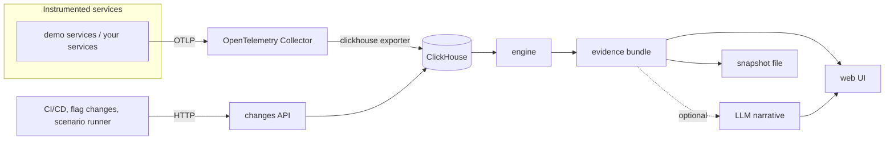

# Architecture

This describes the target design. Parts of it will change as the benchmark shows what works. Decisions that are expensive to reverse are recorded in [`adr/`](adr/).

## Overview



## Components

### Collector

Stock OpenTelemetry Collector (contrib distribution) with the ClickHouse exporter. No custom collector code. The exporter's default tables (`otel_traces`, `otel_logs`, `otel_metrics_*`) are used as they are, so anyone already running that setup can point IncidentLens at their data.

### Changes API (`changes/`, Go)

Small HTTP service that records things that changed: deploys, config changes, feature flag flips, manual notes. It writes to the `incidentlens.changes` table in ClickHouse, in a database separate from the exporter's, and lists events by time window. The engine reads the table directly and does not need the service running.

The service sends no telemetry of its own. Pointed at the same Collector as the demo, it would show up as one more service in every reconstruction.

The event format is the JSON Schema in [`changes/schema/change.schema.json`](../changes/schema/change.schema.json), described with examples in [`changes/README.md`](../changes/README.md). `kind` is one of `deploy`, `config`, `flag`, `note`. Format, IDs and table layout are in [ADR 0005](adr/0005-change-events.md).

### Engine (`engine/`, Python)

Reads a time window from ClickHouse and produces an evidence bundle. Steps:

1. **Service graph.** Join spans on `ParentSpanId` across services to get caller → callee edges with request counts.
2. **Series.** Rate, error ratio and latency percentiles per service and per edge, bucketed (10s to start).
3. **Onset detection.** For each series, find when it left its baseline. The baseline is taken from a period before the window. EWMA and CUSUM are the first candidates. Each onset has a time, a magnitude and the series it came from.
4. **Candidate ranking.** A service is a stronger candidate when its onset comes early, when the services it depends on look healthy while it does not, and when a change event touched it shortly before the onset. The scoring is kept simple and explainable. Every factor that contributed to a score goes into the bundle.
5. **Log templates.** Error and warning logs in the window are grouped with Drain. Templates that appear or spike after an onset are attached to the matching service.
6. **Exemplars.** A few representative failing traces per candidate.

The engine is also the `incidentlens` CLI: `reconstruct`, `bench`, `snapshot`.

### Evidence bundle

Versioned JSON. Every item has a stable ID and references raw data by ID (trace ID, span ID, log record ID, change ID). Sketch:

```json
{
  "schema": "incidentlens.bundle/v0",
  "window": {"start": "...", "end": "..."},
  "graph": {"nodes": [...], "edges": [...]},
  "onsets": [{"id": "on_3", "service": "payments", "signal": "latency.p95", "time": "...", "evidence": ["sp_..."]}],
  "changes": [{"id": "chg_...", "kind": "flag", "service": "payments", "time": "..."}],
  "candidates": [{"id": "cand_1", "service": "payments", "score": 0.81, "factors": [...], "evidence": ["on_3", "chg_...", "lt_12"]}],
  "log_templates": [{"id": "lt_12", "service": "payments", "template": "timeout acquiring connection after <*> ms", "count": 341}]
}
```

### Narrative (optional)

The bundle is sent to an LLM with instructions to write a short postmortem draft where each sentence ends with the IDs it relies on. The response is parsed and every cited ID is checked against the bundle. A sentence with no citations, or with an unknown ID, is removed and logged. What survives is shown next to the evidence it cites.

Providers sit behind one interface: Ollama for local use, plus any API provider. Everything else works with this step turned off.

### Web UI (`web/`, Next.js)

Reads bundles (from the engine API or from a snapshot file). Three views: timeline, service map replay, candidate detail. It has no analysis logic of its own.

### Snapshots

A snapshot is a single file containing the bundle, the narrative if any, and the subset of telemetry the bundle references. The UI can open one without a backend. The public demo is a set of snapshots served statically.

## Demo system (`demo/`)

Four services behind a gateway, small enough to run on a laptop:

| Service | Language | Depends on |
|---|---|---|
| `gateway` | Go | catalog, orders |
| `catalog` | Python | Postgres, Redis |
| `orders` | Go | catalog, payments, Postgres |
| `payments` | Go | Postgres |

All services are instrumented with OpenTelemetry SDKs following the [telemetry conventions](telemetry-conventions.md), and read fault flags from flagd through OpenFeature. A k6 script generates steady traffic with some variation.

## Scenarios (`bench/scenarios/`)

Each scenario is a YAML file describing a fault, how to trigger it and the expected answer: the root cause service, a kind from a closed list, and the symptoms seen on the demo. A scenario can include a change event or deliberately leave it out, since real incidents often have no recorded change. The format is in [`bench/README.md`](../bench/README.md) and [ADR 0004](adr/0004-scenario-format.md).

`incidentlens scenario run` executes a scenario on the compose stack: it sets the flags through flagd, restarts a service with a new version for deploy scenarios, posts the change events and writes a manifest with the window to reconstruct and the expected answer ([ADR 0006](adr/0006-scenario-runs.md), [ADR 0007](adr/0007-deploys-in-scenario-runs.md)).
